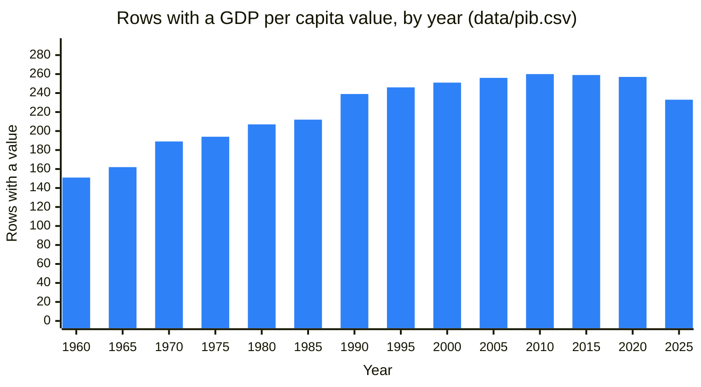
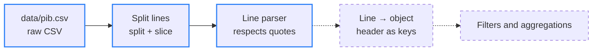

<div align="center">

# 📊 dataInsights

> 🌐 Leia em [Português](./README.md)

<a href="#-how-it-works"></a>

[](#️-technologies-used)

`Plain JavaScript · Node.js · 0 dependencies · MIT`

</div>

A training project for manipulating raw data in plain JavaScript, with no external libraries. The goal is to practice reading, parsing, and analyzing real-world data (CSV) from scratch, including automated tests with Vitest in the upcoming stages. **In progress:** reading the CSV and the line parser that respects quotes already work; turning each line into an object, the filters and aggregations, and the Vitest tests come next.

---

## 📑 Table of Contents

- [🗂️ Project Structure](#️-project-structure)
- [🗂️ Project Structure - tree](#️-project-structure---tree)
- [📦 The dataset](#-the-dataset)
- [🔄 How it works](#-how-it-works)
- [⚙️ Technologies used](#️-technologies-used)
- [🚀 How to run](#-how-to-run)
- [🤝 Contributing](#-contributing)
- [📄 License](#-license)

---

## 🗂️ Project Structure

| Path | Description |
|---|---|
| `data/pib.csv` | Raw GDP per capita dataset by country ([World Bank](https://databank.worldbank.org/source/world-development-indicators), indicator [`NY.GDP.PCAP.CD`](https://data.worldbank.org/indicator/NY.GDP.PCAP.CD)), in original CSV format, with no processing applied (see [The dataset](#-the-dataset)) |
| `src/parser.js` | Reads the CSV and parses each line, correctly handling quoted fields that contain commas (e.g. `"Bahamas, The"`). When run, it prints to the console the array of lines already split into fields |
| `assets/` | Animated header banner in SVG, in Portuguese (`banner-barras.svg`) and in English (`banner-barras.en.svg`): bars with Brazil's real GDP per capita (from 1961 to 2024, every 3 years) growing in a wave and a real CSV line scrolling along the top, with the project's three phrases, animated with CSS only |
| `LICENSE` | MIT license text |
| `README.en.md` | English version of this documentation |
| `README.md` | This documentation in Portuguese |

---

## 🗂️ Project Structure - tree

```
🗂️
├── 📁 assets
│  ├── 🖼️ banner-barras.en.svg
│  └── 🖼️ banner-barras.svg
├── 📁 data
│  └── 📈 pib.csv
├── 📁 src
│  └── ⚙️ parser.js
├── 🗒️ LICENSE
├── 🇺🇸 README.en.md
└── 🇧🇷 README.md
```

---

## 📦 The dataset

| | |
|---|---|
| **Source** | [World Bank: World Development Indicators](https://databank.worldbank.org/source/world-development-indicators) |
| **Indicator** | [GDP per capita in current US$ (`NY.GDP.PCAP.CD`)](https://data.worldbank.org/indicator/NY.GDP.PCAP.CD) |
| **Coverage** | 265 data rows: countries and regional aggregates (e.g. *Africa Eastern and Southern*) |
| **Period** | 1960 to 2025, one column per year (66 years) |
| **Last updated** | Jul 13, 2026 |
| **Format** | Raw CSV: 4 lines before the header (2 of metadata and 2 blank), `\r\n` line breaks and empty cells for years with no data |

- **Coverage:** 2,745 of the 17,490 year cells are empty (15.7%), and 4 rows have no value in any year: Gibraltar, *Not classified*, North Korea (*Korea, Dem. People's Rep.*) and the British Virgin Islands.
- **Quirk:** 17 names have a comma inside the quotes (`"Bahamas, The"`, `"Congo, Dem. Rep."`, `"Hong Kong SAR, China"`…), and they are why the parser exists. The file also starts with the UTF-8 BOM and every line ends with a comma, so each line becomes 71 fields: 4 identifiers, 66 years and 1 empty field at the end.



<sub>Counted on Nov 15, 2026 over the 265 data rows, every 5 years. Coverage grows until 2010 (260 rows) and drops in 2025 because that year is still coming in: 14 rows have a 2024 value and none for 2025 yet.</sub>

<details>
<summary>📋 See the numbers as a table</summary>

| Year | Rows with a value |
|---|---:|
| 1960 | 151 |
| 1965 | 162 |
| 1970 | 189 |
| 1975 | 194 |
| 1980 | 207 |
| 1985 | 212 |
| 1990 | 239 |
| 1995 | 246 |
| 2000 | 251 |
| 2005 | 256 |
| 2010 | 260 |
| 2015 | 259 |
| 2020 | 257 |
| 2025 | 233 |

</details>

---

## 🔄 How it works



<sub>Blue border = already in the code · dashed border = doesn't exist yet · dotted arrow = connection not made yet</sub>

The trickiest part is the parser. A plain `split(",")` breaks country names that contain a comma; the parser walks the line character by character and only splits fields when it is **outside** quotes:

```text
CSV line:        "Bahamas, The","BHS","GDP per capita (current US$)",...
split(","):      ['"Bahamas', ' The"', '"BHS"', ...]            ❌
parseLinesData:  ['Bahamas, The', 'BHS', 'GDP per capita (current US$)', ...]  ✅
```

Real output of `node src/parser.js` (Node.js 22, with the long parts cut to `…`):

```text
[
  [
    'Country Name', 'Country Code', 'Indicator Name', 'Indicator Code',
    '1960',         '1961',         '1962',           '1963',
    …
  ],
  [
    'Aruba',
    'ABW',
    …
  ],
  …
  ... 167 more items
]
```

> [!NOTE]
> The printed array has 267 items, not 265: the first one is the header itself (`slice(4)` only skips the 4 lines above it) and the last one is `[""]`, from the line break at the end of the file. Every line also ends with an empty field, because of the trailing comma. Whoever turns lines into objects, the next step, needs to drop both ends and ignore that last field.

---

## ⚙️ Technologies used

- [JavaScript](https://developer.mozilla.org/en-US/docs/Web/JavaScript): the whole parser, written from scratch, with a loop that walks the line character by character
- [Node.js](https://nodejs.org/): runs `src/parser.js` and reads the file with the built-in [`fs`](https://nodejs.org/api/fs.html) module, with no external libraries
- [Vitest](https://vitest.dev/) (planned: automated tests for the parser and the next steps)

---

## 🚀 How to run

Prerequisite: [Node.js](https://nodejs.org/) installed.

```bash
git clone https://github.com/briandevbr/dataInsights.git
cd dataInsights
node src/parser.js
```

At this stage, the script reads the raw dataset and prints to the console the parsed result of each line (country) already converted into an array of clean fields, with quotes removed and internal commas correctly preserved. Since the array has 267 items, Node shows the first 100 and sums up the rest as `... 167 more items`.

Run it from the project root: the script opens `data/pib.csv` through a relative path, so `cd src && node parser.js` fails with `ENOENT`.

---

## 🤝 Contributing

Personal training project, with no external contribution process at the moment. Suggestions are welcome via [issues](https://github.com/briandevbr/dataInsights/issues).

---

## 📄 License

Distributed under the [MIT](./LICENSE) license: use, study and adapt it freely, keeping the copyright notice. The banner was made for the project and follows the same license. The dataset in `data/pib.csv` belongs to the World Bank and follows its license, [CC BY 4.0](https://creativecommons.org/licenses/by/4.0/).

---

<div align="center">
  <sub>Made by <a href="https://github.com/briandevbr">David Brian</a> · part of my backend study portfolio</sub><br/>
  <sub>Raw CSV → plain JavaScript → insights</sub>
</div>
