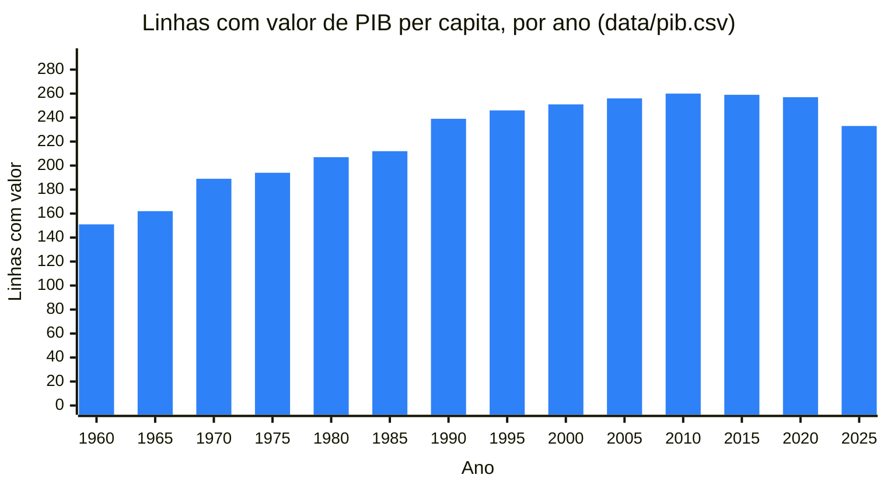
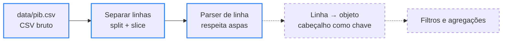

<div align="center">

# 📊 dataInsights

> 🌐 Read this in [English](./README.en.md)

<a href="#-como-funciona"></a>

[](#️-tecnologias-usadas)

`JavaScript puro · Node.js · 0 dependências · MIT`

</div>

Projeto de treino para manipulação de dados brutos em JavaScript puro, sem bibliotecas externas. A ideia é praticar leitura, parsing e análise de dados reais (CSV) do zero, incluindo testes automatizados com Vitest nas próximas etapas. **Em andamento:** a leitura do CSV e o parser de linha que respeita aspas já funcionam; transformar cada linha em objeto, os filtros e agregações e os testes com Vitest vêm a seguir.

---

## 📑 Sumário

- [🗂️ Estrutura do Projeto](#️-estrutura-do-projeto)
- [🗂️ Estrutura do Projeto - tree](#️-estrutura-do-projeto---tree)
- [📦 O dataset](#-o-dataset)
- [🔄 Como funciona](#-como-funciona)
- [⚙️ Tecnologias usadas](#️-tecnologias-usadas)
- [🚀 Como rodar](#-como-rodar)
- [🤝 Contribuindo](#-contribuindo)
- [📄 Licença](#-licença)

---

## 🗂️ Estrutura do Projeto

| Caminho | Descrição |
|---|---|
| `data/pib.csv` | Dataset bruto de PIB per capita por país ([Banco Mundial](https://databank.worldbank.org/source/world-development-indicators), indicador [`NY.GDP.PCAP.CD`](https://data.worldbank.org/indicator/NY.GDP.PCAP.CD)), em formato CSV original, sem nenhum tratamento (ver [O dataset](#-o-dataset)) |
| `src/parser.js` | Leitura do CSV e parser de linha, tratando corretamente campos entre aspas que contêm vírgula (ex: `"Bahamas, The"`). Ao rodar, imprime no console o array de linhas já separadas em campos |
| `assets/` | Banner animado do cabeçalho em SVG, em português (`banner-barras.svg`) e em inglês (`banner-barras.en.svg`): barras com o PIB per capita real do Brasil (de 1961 a 2024, de 3 em 3 anos) crescendo em onda e uma linha real do CSV correndo no topo, com as três frases do projeto, animados só com CSS |
| `LICENSE` | Texto da licença MIT |
| `README.en.md` | Versão em inglês desta documentação |
| `README.md` | Esta documentação em português |

---

## 🗂️ Estrutura do Projeto - tree

```
🗂️
├── 📁 assets
│  ├── 🖼️ banner-barras.en.svg
│  └── 🖼️ banner-barras.svg
├── 📁 data
│  └── 📈 pib.csv
├── 📁 src
│  └── ⚙️ parser.js
├── 🗒️ LICENSE
├── 🇺🇸 README.en.md
└── 🇧🇷 README.md
```

---

## 📦 O dataset

| | |
|---|---|
| **Fonte** | [Banco Mundial: World Development Indicators](https://databank.worldbank.org/source/world-development-indicators) |
| **Indicador** | [PIB per capita em US$ correntes (`NY.GDP.PCAP.CD`)](https://data.worldbank.org/indicator/NY.GDP.PCAP.CD) |
| **Cobertura** | 265 linhas de dados: países e agregados regionais (ex: *Africa Eastern and Southern*) |
| **Período** | 1960 a 2025, uma coluna por ano (66 anos) |
| **Última atualização** | 13/07/2026 |
| **Formato** | CSV cru: 4 linhas antes do cabeçalho (2 de metadados e 2 em branco), quebras de linha `\r\n` e células vazias para anos sem dado |

- **Cobertura:** 2.745 das 17.490 células de ano estão vazias (15,7%), e 4 linhas não têm valor em ano nenhum: Gibraltar, *Not classified*, Coreia do Norte (*Korea, Dem. People's Rep.*) e Ilhas Virgens Britânicas.
- **Peculiaridade:** 17 nomes têm vírgula dentro das aspas (`"Bahamas, The"`, `"Congo, Dem. Rep."`, `"Hong Kong SAR, China"`…), e é por eles que o parser existe. O arquivo também começa com o BOM do UTF-8 e toda linha termina com vírgula, então cada linha vira 71 campos: 4 de identificação, 66 anos e 1 vazio no fim.



<sub>Contagem feita em 15/11/2026 sobre as 265 linhas de dados, de 5 em 5 anos. A cobertura cresce até 2010 (260 linhas) e cai em 2025 porque o ano ainda está chegando: 14 linhas têm valor em 2024 e ainda não em 2025.</sub>

<details>
<summary>📋 Ver os números em tabela</summary>

| Ano | Linhas com valor |
|---|---:|
| 1960 | 151 |
| 1965 | 162 |
| 1970 | 189 |
| 1975 | 194 |
| 1980 | 207 |
| 1985 | 212 |
| 1990 | 239 |
| 1995 | 246 |
| 2000 | 251 |
| 2005 | 256 |
| 2010 | 260 |
| 2015 | 259 |
| 2020 | 257 |
| 2025 | 233 |

</details>

---

## 🔄 Como funciona



<sub>Borda azul = já existe no código · borda tracejada = ainda não existe · seta pontilhada = ligação ainda não feita</sub>

O ponto mais delicado é o parser. Um `split(",")` simples quebra nomes de país que têm vírgula; o parser percorre a linha caractere por caractere e só separa campos quando está **fora** de aspas:

```text
Linha do CSV:    "Bahamas, The","BHS","GDP per capita (current US$)",...
split(","):      ['"Bahamas', ' The"', '"BHS"', ...]            ❌
parseLinesData:  ['Bahamas, The', 'BHS', 'GDP per capita (current US$)', ...]  ✅
```

Saída real de `node src/parser.js` (Node.js 22, com os trechos longos cortados em `…`):

```text
[
  [
    'Country Name', 'Country Code', 'Indicator Name', 'Indicator Code',
    '1960',         '1961',         '1962',           '1963',
    …
  ],
  [
    'Aruba',
    'ABW',
    …
  ],
  …
  ... 167 more items
]
```

> [!NOTE]
> O array impresso tem 267 itens, não 265: o primeiro é o próprio cabeçalho (o `slice(4)` só pula as 4 linhas de cima) e o último é `[""]`, da quebra de linha no fim do arquivo. Cada linha também termina com um campo vazio, por causa da vírgula final. Quem for transformar linha em objeto, a próxima etapa, precisa tirar os dois extremos e ignorar esse último campo.

---

## ⚙️ Tecnologias usadas

- [JavaScript](https://developer.mozilla.org/pt-BR/docs/Web/JavaScript): o parser inteiro, escrito do zero, com um laço que percorre a linha caractere por caractere
- [Node.js](https://nodejs.org/): roda o `src/parser.js` e lê o arquivo com o módulo nativo [`fs`](https://nodejs.org/api/fs.html), sem bibliotecas externas
- [Vitest](https://vitest.dev/) (planejado: testes automatizados do parser e das próximas etapas)

---

## 🚀 Como rodar

Pré-requisito: [Node.js](https://nodejs.org/) instalado.

```bash
git clone https://github.com/briandevbr/dataInsights.git
cd dataInsights
node src/parser.js
```

Neste estágio, o script lê o dataset bruto e imprime no console o resultado do parsing de cada linha (país) já convertido em array de campos limpos, sem aspas e com as vírgulas internas preservadas corretamente. Como o array tem 267 itens, o Node mostra os 100 primeiros e resume o resto em `... 167 more items`.

Rode a partir da raiz do projeto: o script abre `data/pib.csv` pelo caminho relativo, então `cd src && node parser.js` falha com `ENOENT`.

---

## 🤝 Contribuindo

Projeto pessoal de treino, sem processo de contribuição externa no momento. Sugestões são bem-vindas via [issues](https://github.com/briandevbr/dataInsights/issues).

---

## 📄 Licença

Distribuído sob a licença [MIT](./LICENSE): use, estude e adapte à vontade, mantendo o aviso de copyright. O banner foi feito para o projeto e segue a mesma licença. O dataset em `data/pib.csv` é do Banco Mundial e segue a licença dele, a [CC BY 4.0](https://creativecommons.org/licenses/by/4.0/deed.pt-br).

---

<div align="center">
  <sub>Feito por <a href="https://github.com/briandevbr">David Brian</a> · parte do meu portfólio de estudos em backend</sub><br/>
  <sub>CSV bruto → JavaScript puro → insights</sub>
</div>
